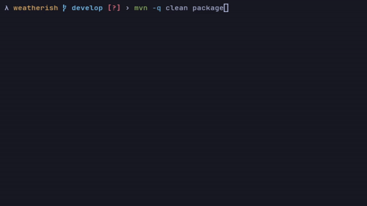

<h1 align="center"> Weatherish


[](https://github.com/laporeon/weatherish/blob/main/LICENSE.md)


</h1>

## Table of Contents

- [About](#about)
- [Requirements](#requirements)
- [Getting Started](#getting-started)
  - [Configure your API key](#1-configure-your-api-key)
  - [Build](#2-build)
  - [Run](#3-run)
  - [Install as a local command](#4-install-as-a-local-command)
      - [Linux / macOS](#linux--macos)
      - [Windows PowerShell](#windows-powershell)
- [Usage](#usage)

## About

Weatherish is a Java-based CLI that fetches current weather data for any city using the OpenWeatherMap API. It 
displays current temperature, feels like, humidity, wind speed and local time, all from your terminal.

## Requirements

- Java 21+ 
- An OpenWeatherMap API key
- Make _(optional)_

Maven is not required because the project includes the Maven Wrapper:

- `./mvnw` for Linux and macOS
- `mvnw.cmd` for Windows

## Getting Started

The project provides a `Makefile` with commands for building, testing, running, and installing the application.

Run `make help` to list all available targets.

> [!NOTE]
> `make` is available out of the box on Linux and macOS. On Windows, use [WSL](https://learn.microsoft.com/windows/wsl/),
> or run the equivalent commands from the table below (use `mvnw.cmd` instead of `./mvnw`).

| Command | Description | Equivalent without Make |
|---|---|---|
| `make help` | Show all available commands | Check the `Makefile` manually |
| `make env` | Create `.env` from `.env.example` if it does not exist | Linux/macOS: `test -f .env || cp .env.example .env`<br>Windows PowerShell: `if (-not (Test-Path .env)) { Copy-Item .env.example .env }` |
| `make build` | Clean and package the executable JAR | Linux/macOS: `./mvnw clean package`<br>Windows: `mvnw.cmd clean package` |
| `make compile` | Compile the project | Linux/macOS: `./mvnw compile`<br>Windows: `mvnw.cmd compile` |
| `make verify` | Run Maven verification | Linux/macOS: `./mvnw verify`<br>Windows: `mvnw.cmd verify` |
| `make clean` | Clean Maven build artifacts | Linux/macOS: `./mvnw clean`<br>Windows: `mvnw.cmd clean` |
| `make run` | Create `.env` if missing, build, and run the application locally | Linux/macOS: `test -f .env || cp .env.example .env; ./mvnw clean package && java -jar target/weatherish.jar`<br>Windows PowerShell: `if (-not (Test-Path .env)) { Copy-Item .env.example .env }; .\mvnw.cmd clean package; java -jar target/weatherish.jar` |
| `make install` | Build and install the `weatherish` command in `~/.local/bin` | Build with `./mvnw clean package`, then create an executable launcher for `target/weatherish.jar` |
| `make uninstall` | Remove the installed `weatherish` command | Linux/macOS: `rm -f "$HOME/.local/bin/weatherish"` |

### 1. Configure your API key

Weatherish requires an API key from [OpenWeatherMap](https://openweathermap.org/api).

Create a local `.env` file from the provided example:

```bash
make env
```

Then edit `.env` and set your API key.

```dotenv
API_KEY=your-api-key
```

You can also configure `API_KEY` as an environment variable.

Linux / macOS:

```bash
export API_KEY=your-api-key
```

Windows Command Prompt:

```cmd
set API_KEY=your-api-key
```

Windows PowerShell:

```powershell
$env:API_KEY = "your-api-key"
```

The application checks the system environment first and uses `.env` as a fallback.

> [!NOTE]
> `set` and `$env:` are session-only on Windows. To persist, add via System Properties → Environment Variables.

### 2. Build

Using Make:

```bash
make build
```

Or using the Maven Wrapper directly:

```bash
# Linux / macOS
./mvnw clean package

# Windows
mvnw.cmd clean package
```

The executable JAR will be generated at:

```text
target/weatherish.jar
```

### 3. Run

Pick the option that fits your workflow:

**Option 1 - Using Make:**

```bash
# Linux / macOS only
make run
```

**Option 2 — Direct JAR execution**

```bash
# Linux / macOS
java -jar target/weatherish.jar

# Windows
java -jar target\weatherish.jar
```

**Option 3 — Wrapper script**

```bash
# Linux / macOS (first time only: make it executable)
chmod +x weatherish
./weatherish

# Windows PowerShell
.\weatherish.bat
```

The wrappers run the JAR generated at `target/weatherish.jar`. Build the application first with
`make build`, `./mvnw clean package`, or `mvnw.cmd clean package`, depending on your platform.

### 4. Install as a local command

#### Linux / macOS

To run `weatherish` from any directory on Linux or macOS:

```bash
make install
```

This creates an executable launcher at:

```text
~/.local/bin/weatherish
```

Make sure `~/.local/bin` is included in your `PATH`:

```bash
export PATH="$HOME/.local/bin:$PATH"
```

To persist this configuration, add it to your shell profile:

```bash
echo 'export PATH="$HOME/.local/bin:$PATH"' >> ~/.bashrc
source ~/.bashrc
```

For Zsh:

```bash
echo 'export PATH="$HOME/.local/bin:$PATH"' >> ~/.zshrc
source ~/.zshrc
```

After installation, run the application from anywhere:

```bash
weatherish
```

To remove the installed command:

```bash
make uninstall
```

#### Windows PowerShell

Build the application first:

```powershell
.\mvnw.cmd clean package
```

Then add the following function to your PowerShell profile, replacing `C:\full\path\to\weatherish` with the absolute path to your project directory.

```powershell 
function weatherish {
    java -jar "C:\full\path\to\weatherish\target\weatherish.jar"
}
```

Save the file, and reload the profile:

```powershell
. $PROFILE
```

After that, run the application from any directory:

```powershell
weatherish
```

> [!NOTE]
> The PowerShell function is available only in PowerShell.
> It does not create a command for Command Prompt.

## Usage

Run the application using one of the available options.

The CLI will prompt you for:

1. The city name.
2. The measurement unit:
    - Metric: Celsius and kilometers per hour.
    - Imperial: Fahrenheit and miles per hour.

Example:

```text
Enter city name: São Paulo

Choose a measurement unit:
[1] Metric (°C, km/h)
[2] Imperial (°F, mph)

Enter your choice: 1
```



[⬆ Back to the top](#-weatherish)
