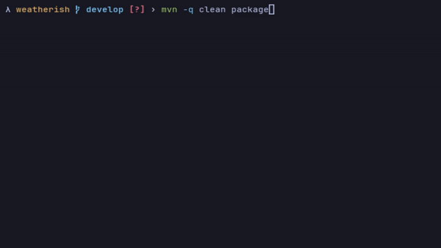

<h1 align="center"> Weatherish


[](https://github.com/laporeon/weatherish/blob/main/LICENSE.md)


</h1>

## Table of Contents

- [About](#about)
- [Requirements](#requirements)
- [Getting Started](#getting-started)
  - [Configure your API key](#1-configure-your-api-key)
  - [Build and run](#2-build-and-run)
  - [Install as a local command](#3-install-as-a-local-command)
- [Usage](#usage)

## About

Weatherish is a Java-based CLI that fetches current weather data for any city using the OpenWeatherMap API. It
displays current temperature, feels like, humidity, wind speed and local time, all from your terminal.

## Requirements

- Java 21+
- An OpenWeatherMap API key
- Make _(optional)_

> [!NOTE]
> - The project ships with the Maven Wrapper, so a global Maven installation is not required.

## Getting Started

The project provides a `Makefile` with commands for building, running, and installing the application.
Run `make help` to list all available targets.

| Command | Description |
|---|---|
| `make help` | Show all available commands |
| `make env` | Create `.env` from `.env.example` if it does not exist |
| `make build` | Clean and package the executable JAR |
| `make compile` | Compile the project |
| `make verify` | Run Maven verification |
| `make clean` | Clean Maven build artifacts |
| `make run` | Create `.env` if missing, build, and run the application locally |
| `make install` | Build and install the `weatherish` command in `~/.local/bin` |
| `make uninstall` | Remove the installed `weatherish` command |

> [!NOTE]
> `make` is available out of the box on Linux and macOS. On Windows, use [WSL](https://learn.microsoft.com/windows/wsl/)
> or the Maven Wrapper commands shown in the sections below.

### 1. Configure your API key

Weatherish requires an API key from [OpenWeatherMap](https://openweathermap.org/api).

Create a local `.env` file from the provided example (or copy `.env.example` to `.env` manually) and set your API key:

```bash
make env
```

```dotenv
API_KEY=your-api-key
```

Alternatively, configure `API_KEY` as an environment variable:

```bash
# Linux / macOS
export API_KEY=your-api-key

# Windows Command Prompt
set API_KEY=your-api-key

# Windows PowerShell
$env:API_KEY = "your-api-key"
```

The application checks the system environment first and uses `.env` as a fallback.

> [!NOTE]
> `set` and `$env:` are session-only on Windows. To persist, add via System Properties → Environment Variables.

### 2. Build and run

Build the executable JAR, generated at `target/weatherish.jar`:

```bash
# Using Make
make build

# Linux / macOS
./mvnw clean package

# Windows
mvnw.cmd clean package
```

Then run it using one of the options below:

```bash
# Using Make (Linux / macOS only — also creates .env and builds before running)
make run

# Direct JAR execution
java -jar target/weatherish.jar        # Linux / macOS
java -jar target\weatherish.jar        # Windows

# Wrapper scripts
chmod +x weatherish && ./weatherish    # Linux / macOS (chmod only needed the first time)
.\weatherish.bat                       # Windows PowerShell
```

### 3. Install as a local command

**Linux / macOS**

```bash
make install # Install the weatherish command in ~/.local/bin.
```

> [!NOTE]
> Make sure `~/.local/bin` is in your `PATH` by adding `export PATH="$HOME/.local/bin:$PATH"` to your shell profile (`~/.bashrc` or `~/.zshrc`).

After that, run `weatherish` from any directory. To remove it, run `make uninstall`.

**Windows PowerShell**

After building the application, add the following function to your PowerShell profile, replacing
`C:\full\path\to\weatherish` with the absolute path to your project directory:

```powershell
function weatherish {
    java -jar "C:\full\path\to\weatherish\target\weatherish.jar"
}
```

Reload the profile with `. $PROFILE` and run `weatherish` from any directory.

> [!NOTE]
> The function is available only in PowerShell, not in Command Prompt.

## Usage

Run the application using one of the available options. The CLI will prompt you for:

1. The city name.
2. The measurement unit:
    - Metric: Celsius and kilometers per hour.
    - Imperial: Fahrenheit and miles per hour.

```text
Enter city name: São Paulo

Choose a measurement unit:
[1] Metric (°C, km/h)
[2] Imperial (°F, mph)

Enter your choice: 1
```



[⬆ Back to the top](#-weatherish)
